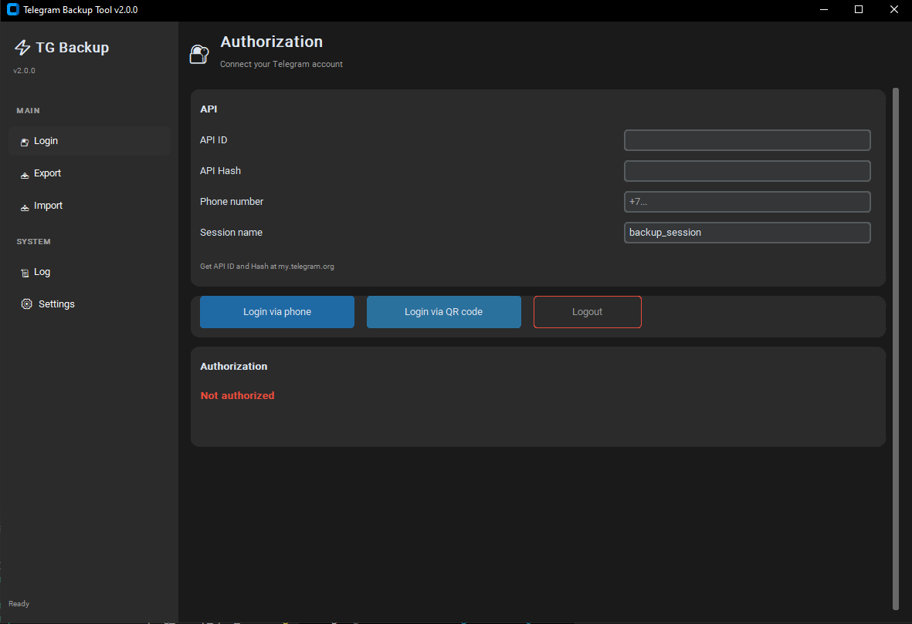
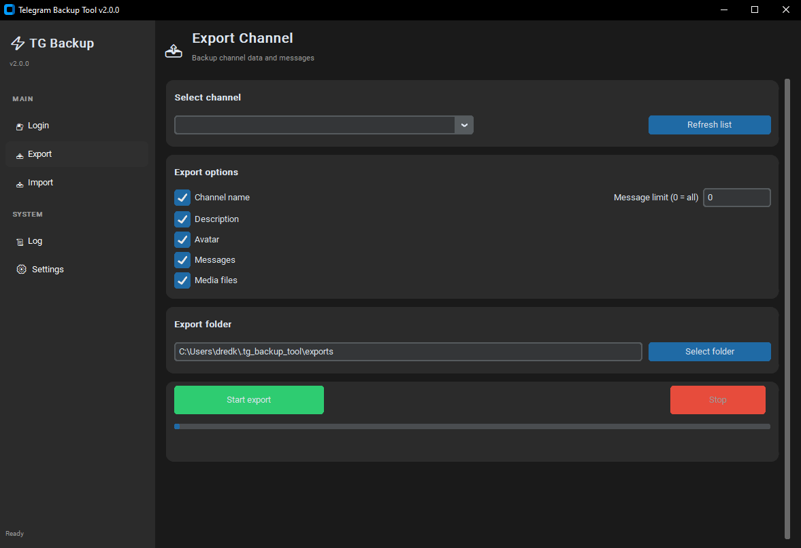
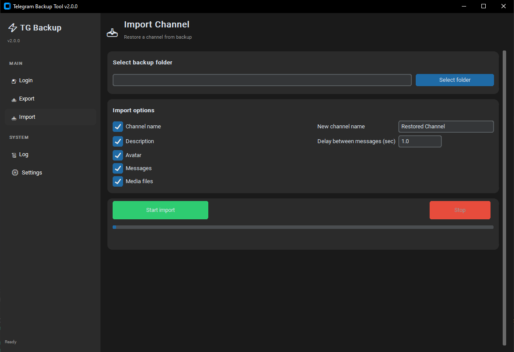
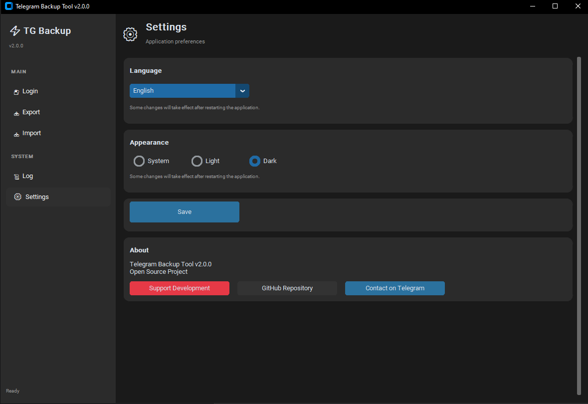

<div align="center">

# 📦 Telegram Backup Tool

**A modern open-source desktop app for backing up and restoring Telegram channels.**

Export messages, media files, avatars and channel info — then restore them to any channel with one click.

[](https://www.python.org/)
[](https://github.com/TomSchimansky/CustomTkinter)
[](https://github.com/LonamiWebs/Telethon)
[](LICENSE)
[]()
[]()

[Features](#-features) • [Installation](#-installation) • [Usage](#-usage) • [FAQ](#-faq) • [Support](#-support-the-project)

</div>

---

## 📖 About

**Telegram Backup Tool** is a free, open-source desktop application that lets you create complete backups of your Telegram channels and restore them later. Perfect for:

- **Archiving** — protecting your channel content from accidental deletion or blocking
- **Migration** — moving channels between accounts
- **Content preservation** — saving rare or valuable media before it disappears
- **Testing** — quickly replicating a channel to experiment with content

The app uses the official [Telegram API](https://my.telegram.org/) through Telethon, so no third-party servers see your data. Everything runs **locally on your machine**.

---

## ✨ Features

- 🔐 **Two login methods** — phone number + SMS code, or QR-code scan
- 📤 **Full channel export** — name, description, avatar, messages, media files
- 📥 **One-click import** — restore a backed-up channel to a new one
- 💬 **Media preservation** — photos, videos, documents, audio
- 🔢 **Message limit** — export only the last N messages if you want
- 🌍 **9 languages** — English, Русский, Español, Português, Deutsch, Français, Türkçe, فارسی, 中文
- 🎨 **Modern UI** — built with CustomTkinter, dark/light themes
- ⚡ **Async core** — the UI never freezes during long operations
- 📜 **Built-in event log** — see exactly what's happening
- 🔒 **100% local** — no data ever leaves your computer
- 🆓 **Free & open source** — no license keys, no subscriptions

---

## 📸 Screenshots

<div align="center">

| Login | Export |
|:---:|:---:|
|  |  |

| Import | Settings |
|:---:|:---:|
|  |  |

</div>

---

## 🚀 Installation

### Option 1: Download prebuilt executable (recommended)

Grab the latest release for your OS from the [Releases page](https://github.com/Igor-Shelloff/tg-backup-tool/releases/latest):

- **Windows** — `TGBackupTool-Windows.exe`
- **Linux** — `TGBackupTool-Linux` (make it executable with `chmod +x`)
- **macOS** — `TGBackupTool-macOS.zip` (unzip and drag `TGBackupTool.app` into Applications)

> ⚠️ **macOS:** The app is not code-signed. On first launch macOS may block it. To allow it, open **Terminal** and run:
> ```
> xattr -cr /Applications/TGBackupTool.app
> ```
> Alternatively: right-click the app → **Open** → **Open** in the dialog.

No Python installation required. Just run it.

### Option 2: Run from source

**Requirements:** Python 3.10 or newer.

```bash
git clone https://github.com/Igor-Shelloff/tg-backup-tool.git
cd tg-backup-tool
python -m venv venv

# Windows
venv\Scripts\activate

# Linux / macOS
source venv/bin/activate

pip install -r requirements.txt
python main.py
```

---

## 📚 Usage

### 1. Get your Telegram API credentials

1. Go to [my.telegram.org](https://my.telegram.org)
2. Log in with your phone number
3. Open **API Development Tools** and create a new app
4. Copy your **API ID** and **API Hash**

### 2. Authorize

Open the **Login** tab, paste your API ID, API Hash and phone number, then click:

- **Login via phone** → enter the code Telegram sends you (and your 2FA password if enabled)
- **Login via QR code** → open Telegram → Settings → Devices → Scan QR

### 3. Export a channel

1. Go to the **Export** tab
2. Click **Refresh list** to load your channels
3. Pick a channel from the dropdown
4. Choose what to export (name, description, avatar, messages, media)
5. Optionally set a message limit (`0` = all messages)
6. Select an export folder and click **Start export**

The result is a folder containing `channel_data.json` + a `media/` directory.

### 4. Import (restore) a channel

1. Go to the **Import** tab
2. Select the backup folder
3. Choose what to restore
4. Set the name for the new channel and a delay between messages (1–3 sec recommended)
5. Click **Start import**

> ⚠️ **Note:** Telegram limits how many messages you can send in a short period. Large channels may take hours or days to fully restore. The recommended delay is 1–3 seconds per message.

---

## 🌍 Supported Languages

| Code | Language | Native |
|:---:|:---:|:---:|
| `en` | English | English |
| `ru` | Russian | Русский |
| `es` | Spanish | Español |
| `pt` | Portuguese | Português |
| `de` | German | Deutsch |
| `fr` | French | Français |
| `tr` | Turkish | Türkçe |
| `fa` | Persian | فارسی |
| `zh` | Chinese | 中文 |

Want to add a new language? Just drop a new `xx.json` file into `app/locales/` following the structure of `en.json` — it will appear in Settings automatically.

---

## ❓ FAQ

**Q: Is this safe to use?**
Yes. All data is stored locally on your computer. The app communicates only with Telegram's official API and never sends your messages to third-party servers.

**Q: How many channels can I export?**
As many as you want. No limits.

**Q: Windows SmartScreen blocks the launch — what do I do?**
Click **More info** → **Run anyway**. This happens because the executable is not code-signed. The source code is fully open — you can build it yourself if you prefer.

**Q: macOS says the app is damaged — what to do?**
Open Terminal and run `xattr -cr /Applications/TGBackupTool.app`. This clears the quarantine flag that macOS adds to unsigned apps. Then launch the app normally.

**Q: Can I restore to the same channel?**
No — Telegram doesn't allow bulk message deletion or re-upload into an existing channel. The import creates a **new channel** from your backup.

**Q: Does it work with group chats?**
Currently only broadcast channels (not megagroups). Support for megagroups is on the roadmap.

**Q: Where are my sessions stored?**
In `~/.tg_backup_tool/sessions/`. Delete that folder to fully log out.

---

## 🛠 Tech Stack

- **Python 3.10+** — core language
- **[CustomTkinter](https://github.com/TomSchimansky/CustomTkinter)** — modern UI toolkit
- **[Telethon](https://github.com/LonamiWebs/Telethon)** — Telegram API client
- **[qrcode](https://github.com/lincolnloop/python-qrcode)** + **Pillow** — QR code generation
- **[cryptg](https://github.com/cher-nov/cryptg)** — fast crypto backend for Telethon

---

## 💖 Support the Project

If this tool saved you time and you'd like to say thanks:

- ⭐ **Star the repo** — it helps other people find it
- 🐛 **Report bugs** or suggest features in [Issues](https://github.com/Igor-Shelloff/tg-backup-tool/issues)
- 💰 **Donate** — [Boosty](https://boosty.to/igorshelloffdev)
- 📩 **Contact** — [@igor_shelloff](https://t.me/igor_shelloff)

Every star and issue helps make the project better.

---

## 📄 License

This project is licensed under the **MIT License** — see the [LICENSE](LICENSE) file for details.

You're free to use, modify and distribute it, including commercially. Attribution is appreciated but not required.

---

## 👤 Author

**Igor Shilov** — Full-Stack Developer

- GitHub: [@Igor-Shelloff](https://github.com/Igor-Shelloff)
- Telegram: [@igor_shelloff](https://t.me/igor_shelloff)
- Email: igor.shilov93@mail.ru
